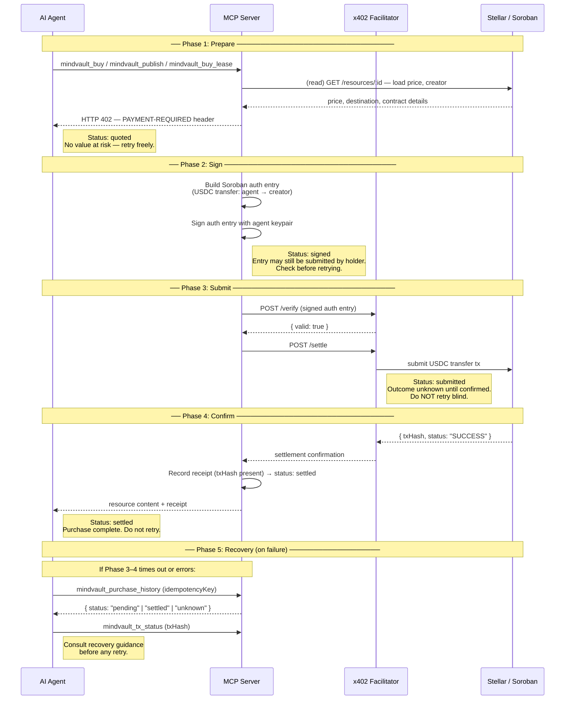

# MCP Transaction Lifecycle — Diagram and Status Glossary

This document covers the five phases a Soroban operation passes through when
submitted via an MCP tool, defines every status value an agent can observe,
and explains what to do when a submission produces an ambiguous outcome.

## Overview

Soroban operations submitted by MCP tools go through five ordered phases:

```
Prepare → Sign → Submit → Confirm → (Recovery on failure)
```

Each phase has a distinct set of outcomes. Understanding which phase a failure
occurred in determines whether a retry is safe.

---

## Lifecycle Diagram



---

## Status Glossary

### Payment / receipt statuses

These are the values returned by `mindvault_purchase_history` and embedded in
tool responses.

| Status | Meaning | Safe to retry? |
| --------- | ----------------------------------------------------------------------- | -------------- |
| `unknown` | No receipt with this idempotency key exists in the local store. The attempt may never have started, or the response was lost before the client could record it. | Check `mindvault_tx_status` if you have a tx hash. Only retry if the tx is confirmed absent on-chain. |
| `pending` | A receipt exists but no on-chain transaction hash was captured. The operation was at least submitted; settlement may be in flight. | Do **not** retry blind. Use `mindvault_tx_status` to check. |
| `settled` | A receipt exists with a confirmed `txHash`. The USDC transfer landed on-chain. | Do **not** retry — payment already completed. |
| `failed` | The receipt was recorded but settlement is known to have failed on-chain. | Safe to retry after confirming the original tx is definitively absent. |

### Soroban transaction statuses (from `mindvault_tx_status`)

| Status | Meaning |
| ----------- | -------------------------------------------------------------------- |
| `SUCCESS` | Transaction confirmed on-chain. Do not retry. |
| `FAILED` | Transaction submitted but rejected by the network (e.g. fee too low, entry expired). Retry is safe. |
| `NOT_FOUND` | No transaction with this hash found. Either it was never submitted, or it has not yet been ingested. Wait one ledger (~5 s) and poll once before concluding it is absent. |

### Payment-stage classifications (from `paymentRetry.ts`)

The MCP server internally classifies how far a payment got before a failure.
This classification drives the action guidance in error responses.

| Stage | Description | Double-spend risk? |
| ----------- | -------------------------------------------------------------------------- | ------------------ |
| `quoted` | Resource returned HTTP 402. Nothing was signed; no value left the wallet. | No |
| `declined` | Client refused before constructing a payment (ceiling exceeded, underfunded, no wallet). | No |
| `signed` | Auth entry was built and signed but not confirmed as submitted. A signed Soroban entry can still be submitted by any party holding it. | Yes — check before retrying |
| `submitted` | Auth entry was submitted to the facilitator. Outcome is unknown. | Yes — check before retrying |
| `settled` | Settlement confirmed on-chain before the failure. The error came after payment. | Yes — do not retry |

---

## State transition rules

A receipt starts in `Escrowed` when first recorded by the registry contract and
moves to `Settled` once `settle_payment` is called by an authorised settler.
The reverse transition (`Settled → Escrowed`) is not permitted. A receipt
created directly in `Settled` state is not permitted either.

```
[Recorded] → Escrowed → Settled
```

An MCP client's local `purchaseHistory` store mirrors this using the
`PurchaseStatus` enum (`unknown / pending / settled / failed`), which is derived
from the presence and value of `txHash` on the stored receipt.

---

## Ambiguous submission behaviour

When a tool call times out after `submitted` or when the network is unreachable
after a facilitator response, the MCP server cannot know whether the transaction
settled. This is by design: the Stellar network is eventually consistent and
Soroban transactions can be ingested up to the ledger expiry of the auth entry
(roughly the entry's configured `valid_until_ledger_sequence`).

**Recommended agent workflow on ambiguous response:**

1. Call `mindvault_purchase_history` with the original `idempotencyKey`.
   - If `status === "settled"`, the payment completed. Do not retry.
   - If `status === "pending"` with a known `txHash`, proceed to step 2.
   - If `status === "unknown"`, wait one ledger and poll once more before
     treating the attempt as absent.

2. Call `mindvault_tx_status` with the `txHash`.
   - `SUCCESS` → settled. Do not retry.
   - `FAILED` → definitively absent. Retry is safe.
   - `NOT_FOUND` → still unconfirmed. Wait up to 30 s (6 ledgers) before
     concluding the transaction did not land.

3. Only retry after confirming the original is absent or failed. Retrying a
   `submitted` payment without this check can result in paying twice.

---

## Error guidance by failure point

| Failure point | Recommended action |
| ----------------------------------- | ------------------------------------------------------------------- |
| 402 not resolved (quoted) | Raise `maxAutoPayUsdc` or fund the wallet. |
| Ceiling exceeded (declined) | Pass `maxAutoPayUsdc` ≥ price, or increase `MINDVAULT_MAX_AUTO_PAY_USDC`. |
| Signature rejected (signed) | Check facilitator availability; the signed entry may be stale. Retry once the original is confirmed absent. |
| Submit timeout (submitted) | Consult `mindvault_purchase_history` + `mindvault_tx_status` before retrying. |
| Settlement confirmed, delivery failed (settled) | The USDC was transferred. Contact support or access the resource directly via its URL. |

---

## See also

- [x402 sequence diagram](x402-sequence-diagram.md) — full x402 buy flow with network detail
- [x402 retry classification](mcp-x402-retry-classification.md) — per-error retry safety table
- [x402 payment troubleshooting](x402-payment-troubleshooting.md) — common failures and fixes
- [MCP error codes](mcp-error-codes.md) — structured error reference
- [MCP error reference](mcp-error-reference.md) — human-readable error descriptions
